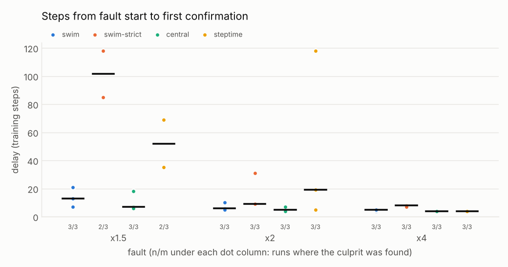
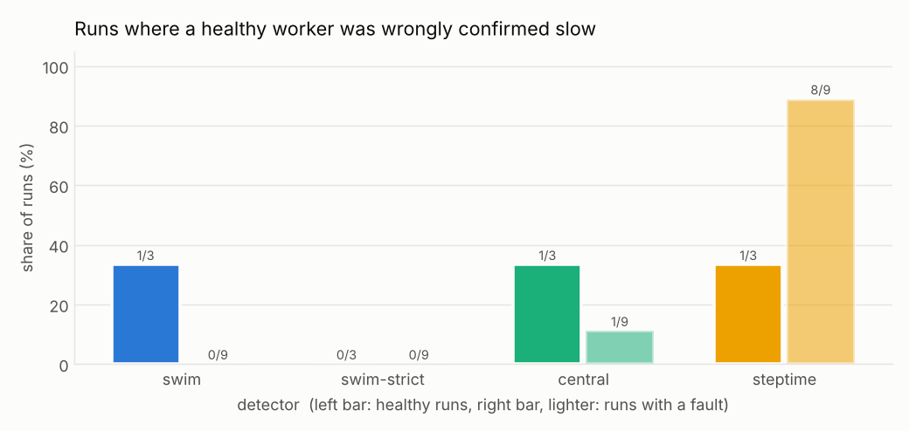
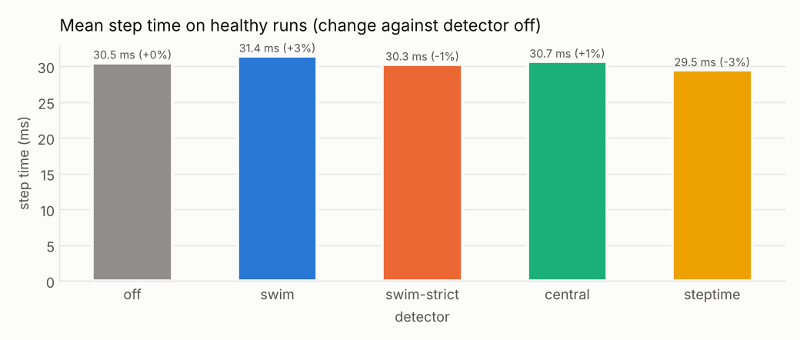

# Results: main

Measured on 2026-10-24: 4 workers, backend `gloo`, 2 processors, Linux-6.18.44-fc-v153-x86_64-with-glibc2.39, Python 3.13.17, torch 2.14.1+cu130. Up to 3 repeats per cell (seed changes per repeat; every detector sees the same seeds). Sweep definition: `results/main/sweep.yaml`; every run: `results/main/runs.jsonl`.

Timing on a shared machine is noisy, and the number of runs per cell is small: treat differences of a few steps, or of one false confirmation, as noise.

**Detection with a slow worker** (delay = steps from fault start to the first confirmation, median and range over the runs where the culprit was found)

| detector | fault | culprit found | delay (steps) | everyone knew after (steps) | runs with a false confirmation | measured slowdown |
|---|---|---|---|---|---|---|
| swim | x1.5 | 3 of 3 | 13 (7–21) | 14 | 0 of 3 | x1.54 |
| swim-strict | x1.5 | 2 of 3 | 101.5 (85–118) | 102.5 | 0 of 3 | x1.53 |
| central | x1.5 | 3 of 3 | 7 (6–18) | - | 0 of 3 | x1.56 |
| steptime | x1.5 | 2 of 3 | 52.0 (35–69) | - | 2 of 3 | x1.51 |
| swim | x2 | 3 of 3 | 6 (5–10) | 7 | 0 of 3 | x2.34 |
| swim-strict | x2 | 3 of 3 | 9 (9–31) | 10 | 0 of 3 | x1.93 |
| central | x2 | 3 of 3 | 5 (4–7) | - | 1 of 3 | x2.13 |
| steptime | x2 | 3 of 3 | 19 (5–118) | - | 3 of 3 | x2.14 |
| swim | x4 | 3 of 3 | 5 (4–5) | 6 | 0 of 3 | x4.47 |
| swim-strict | x4 | 3 of 3 | 8 (7–8) | 9 | 0 of 3 | x4.34 |
| central | x4 | 3 of 3 | 4 (4–4) | - | 0 of 3 | x4.79 |
| steptime | x4 | 3 of 3 | 4 (4–4) | - | 3 of 3 | x4.31 |

**Healthy runs** (no fault: every confirmation is wrong)

| detector | runs | runs with a false confirmation | false confirmations | false suspicions |
|---|---|---|---|---|
| swim | 3 | 1 of 3 | 1 | 5 |
| swim-strict | 3 | 0 of 3 | 0 | 0 |
| central | 3 | 1 of 3 | 3 | 0 |
| steptime | 3 | 1 of 3 | 5 | 0 |

**Cost** (mean step time on healthy runs)

| detector | mean step (ms) | change against off |
|---|---|---|
| off | 30.5 | +0.0% |
| swim | 31.4 | +3.0% |
| swim-strict | 30.3 | -0.8% |
| central | 30.7 | +0.6% |
| steptime | 29.5 | -3.4% |

Notes: the step-time detector can only accuse its own worker; in synchronous training every step time rises together, so its false confirmations are healthy workers accusing themselves. The central monitor sees every compute time directly and does not vote, which makes it faster, but one worker receives every report and nobody decides if it fails.
